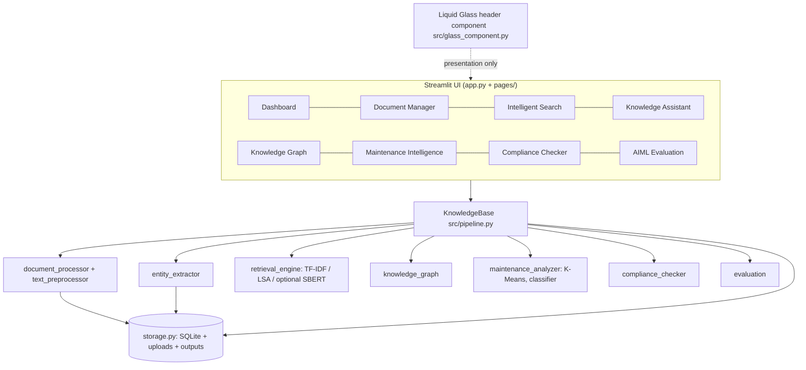
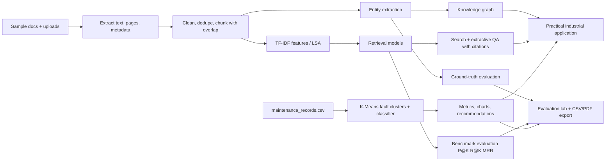

> **v2.0 — Pastel Liquid Glass + NVIDIA NIM AI Assistant** (October 2025)
> - Complete UI redesign: soft pastel Liquid Glass theme (#F7F9FC background, sky/mint/blush/butter/lavender palette)
> - NVIDIA NIM AI Knowledge Assistant powered by 
vidia/llama-3.1-nemotron-70b-instruct
> - Consolidated navigation to 7 pages (Compliance & Evaluation merged)
> - All charts updated to pastel color scales; improved sidebar full-height styling
> - Added openai + python-dotenv dependencies; .env.example included

---
# Industrial Knowledge Intelligence - Unified Asset & Operations Brain

An **academic AI/ML mini-project** (Python + Streamlit) that ingests industrial documents, extracts entities, builds a searchable
knowledge base, answers questions with cited evidence, links everything in a knowledge graph, analyses maintenance records
(K-Means clustering + baseline classifier), checks illustrative compliance rules and **evaluates every model from real predictions**.
The UI uses the **Liquid Glass JS** library (genuine WebGL refraction in the header, CSS frosted glass elsewhere - see section 19).

> **All data are fictional/synthetic.** This is a prototype for study, not a system for controlling real equipment, and the compliance rules are illustrative, not legal advice.

---
## 1. Abstract
Industrial knowledge is scattered across manuals, logs, inspection reports and spreadsheets. This project builds a local pipeline
(ingestion -> preprocessing -> TF-IDF / LSA retrieval, rule-based entity extraction, K-Means fault clustering, a supervised baseline) and an
application layer (search, extractive QA, knowledge graph, maintenance and compliance analytics). Models are evaluated against hand-labelled
ground truth with precision/recall/F1, Precision@K, Recall@K, MRR, accuracy and confusion matrices. Everything runs offline on a laptop without a GPU or paid API.

## 2. Problem statement
Finding the right maintenance record, manual passage or safety procedure across disconnected files is slow, causing maintenance delays,
compliance gaps and loss of operational knowledge.

## 3. Objectives
1. Ingest PDF/DOCX/TXT/CSV, clean text and chunk it with overlap. 2. Extract equipment, components, faults, actions, regulations, dates, safety text.
3. Provide keyword (TF-IDF) and latent-semantic (LSA) search (+ optional neural search). 4. Answer questions from evidence only, with citations.
5. Build an evidence-linked knowledge graph. 6. Cluster faults, find recurring issues, train a baseline risk model. 7. Check illustrative compliance rules.
8. Evaluate honestly and export results.

## 4. Existing-system limitations
Folder/file-name search misses content; no link between a fault, its component and past fixes; manual compliance tracking; tacit knowledge lost when staff leave; no measured retrieval quality.

## 5. Proposed-system overview
A modular Python application (`src/` = logic, `pages/` = Streamlit screens, `assets/` = theme + Liquid Glass). A single `KnowledgeBase` object (`src/pipeline.py`)
connects the stages so that every page reads the same processed data.

## 6. Software and hardware requirements
Windows 10/11, Python 3.10-3.12 (developed on 3.12), VS Code, 8 GB RAM, no GPU. A modern browser (Chrome/Edge/Firefox). Optional: Tesseract OCR; internet only for the optional neural model.

## 7. System architecture

## 8. End-to-end workflow

## 9. Module descriptions
| Module | Role |
|---|---|
| `src/storage.py` | SQLite tables (documents, chunks, entities, search_log), safe upload saving (never overwrites), path-inside-project checks, CSV export |
| `src/text_preprocessor.py` | `clean_text`, `split_sentences`, sentence-aware overlapping `chunk_text`, `clean_dataframe`, content hashing |
| `src/document_processor.py` | PDF (PyMuPDF, OCR fallback), DOCX (paragraphs + tables), TXT, CSV; status/warning/error per file; page numbers |
| `src/entity_extractor.py` | Regex + domain lexicon + negation + safety-sentence rules; each row marked *extracted* or *inferred* |
| `src/retrieval_engine.py` | TF-IDF cosine, LSA (TruncatedSVD), optional Sentence-Transformers; honest availability reporting |
| `src/knowledge_assistant.py` | Extractive QA with relevance thresholds, asset-ID grounding and refusal |
| `src/knowledge_graph.py` | Evidence-linked edges, NetworkX graph, PyVis / Plotly rendering |
| `src/maintenance_analyzer.py` | TF-IDF + K-Means (k by silhouette), recurrence, recommendations, classifier (LR, RF, dummy) |
| `src/compliance_checker.py` | Requirement x asset checks, audit CSV/PDF |
| `src/evaluation.py` | PRF, P@K, R@K, MRR, entity and retrieval evaluation, metrics export |
| `src/pipeline.py` | `KnowledgeBase`: ties ingestion -> models -> evaluation |
| `src/ui.py`, `src/glass_component.py`, `assets/` | Presentation only (theme, cards, Liquid Glass) |

## 10. Dataset description and data dictionary
All fictional. 9 narrative documents (7 TXT, 1 DOCX, 1 two-page PDF) + 2 CSV tables, regenerated by `tools/generate_sample_data.py` (fixed seed 42; hand-written "anchor" work orders agree with the narrative documents).
Assets: pumps P-101/P-102, motors M-401/M-402, compressors C-202/C-205, boilers B-301/B-302.

**`maintenance_records.csv`** (120 rows): `work_order_id`, `date`, `equipment_id`, `equipment_type`, `component`, `fault_description`, `fault_label` (synthetic template category - *only* used to validate clustering, never as model input), `action_taken`, `downtime_hours` (2 missing values deliberately), `department`, `operating_hours_since_overhaul`, `days_since_last_pm`, `vibration_mm_s`, `temperature_c`, `failure_within_30d` (synthetic target from a noisy logistic rule), `severity`.
**`inspection_records.csv`** (12): `inspection_id`, `date`, `equipment_id`, `inspection_type`, `department`, `finding`, `status` (Pass/Observation/Fail), `next_due_date`.
**`compliance_requirements.csv`** (9 fictional rules): `requirement_id`, `title`, `requirement_text`, `check_type` (periodic_inspection / follow_up / documented_procedure), `applies_to`, `inspection_type`, `max_interval_days`, `evidence_keywords`.
**`entity_ground_truth.csv`** (125 labels, 9 documents): `document`, `entity_type`, `value` - hand-labelled from reading the documents. **`retrieval_benchmark.csv`** (18 queries): `query`, `relevant_documents` (`;`-separated).

*Annotation guideline for faults:* label affirmed fault/symptom concepts from a fixed list (overheating, bearing failure, seal leakage, leakage, cavitation, vibration, misalignment, imbalance, noise, corrosion, fouling, scaling, drift, trip, flame failure); do not label negated mentions ("no corrosion found") or operating thresholds ("vibration must remain below 4.5 mm/s").

## 11. Preprocessing methodology
Unicode NFKC, control-character removal, hyphenation and line-wrap repair, whitespace collapse -> sentence splitting -> **sentence-aware chunks of ~90 words with ~20 words overlap** (CSV rows = one chunk each) -> content-hash duplicate detection ->
for tables: strip strings, parse dates, drop duplicate work orders, drop rows without date/equipment, median-impute missing downtime -> TF-IDF features (uni+bi-grams, sublinear tf, light stemming, asset IDs kept as tokens).
The Document Manager shows before/after text, chunks, TF-IDF vocabulary/sparsity and the maintenance cleaning report.

## 12. ML/NLP algorithms and why
| Task | Algorithm | Why |
|---|---|---|
| Keyword retrieval | TF-IDF + cosine | Transparent, fast, strong for exact IDs (P-101) and technical terms |
| Latent-semantic retrieval | TruncatedSVD on TF-IDF (LSA) | Local, no download; captures co-occurring vocabulary. **Not** a neural embedding |
| Neural semantic (optional) | Sentence-Transformers MiniLM | Real embeddings when installed; reported unavailable otherwise, never faked |
| Entities | Regex + lexicon + negation + sentence rules | Deterministic, explainable; no labelled corpus large enough to train NER |
| Fault grouping | TF-IDF + K-Means, k by silhouette | Unsupervised; interpretable cluster terms |
| Risk baseline | Logistic Regression, Random Forest vs majority dummy | Simple baselines with stratified split, pipeline-internal scaling (no leakage) |
| Vector search | Exact NumPy dot product on normalised vectors | Enough for thousands of chunks; avoids FAISS install pain on Windows |

## 13. Training and evaluation methodology
* **Entities:** set-based comparison per document and type against `entity_ground_truth.csv`; micro/macro precision, recall, F1; FP/FN error table.
* **Retrieval:** document-level ranking (best chunk per document); P@1/3/5, R@1/3/5, MRR over `retrieval_benchmark.csv`; latency per query.
* **Classification:** stratified 75/25 split (seed 42); scaler/encoder fit inside the pipeline on training rows only; 5-fold CV on **train only**; test set touched once; compared with a majority-class dummy; features exclude the target, `fault_label`, `severity`, `downtime`.
* **Clustering:** silhouette (internal) + ARI/NMI against synthetic template labels (external, validation only).
* No metric is hardcoded; `src/evaluation.py` computes all of them and `tests/test_core.py` checks them against hand-calculated values.

## 14. Actual results from the included benchmark
Produced by the app on the sample data (re-computed live on the **AIML Evaluation** page; seed 42).

**Entity extraction** (9 labelled docs; micro P 0.961 / R 0.992 / F1 0.976; macro F1 0.980)
| type | gold | TP | FP | FN | P | R | F1 |
|---|---|---|---|---|---|---|---|
| asset_id | 15 | 15 | 0 | 0 | 1.000 | 1.000 | 1.000 |
| component | 46 | 46 | 0 | 0 | 1.000 | 1.000 | 1.000 |
| fault | 30 | 30 | 3 | 0 | 0.909 | 1.000 | 0.952 |
| maintenance_action | 29 | 28 | 2 | 1 | 0.933 | 0.966 | 0.949 |
| regulatory_reference | 5 | 5 | 0 | 0 | 1.000 | 1.000 | 1.000 |

Errors (all listed in the app): FP `trip` (a setpoint, not an event), FP `vibration` x2 (limits/readings), FP `test` x2 ("test run", "tested detector"), FN `inspect` (noun "inspection" is not matched).

**Retrieval** (18 queries, document level)
| mode | P@1 | P@3 | P@5 | R@1 | R@3 | R@5 | MRR | ms/query |
|---|---|---|---|---|---|---|---|---|
| Keyword TF-IDF | 0.611 | 0.444 | 0.344 | 0.380 | 0.741 | 0.954 | 0.759 | ~2 |
| Latent semantic LSA | 0.556 | 0.444 | 0.356 | 0.352 | 0.731 | 0.972 | 0.741 | ~2 |
| Neural SBERT | *not evaluated - sentence-transformers not installed/loaded in the test environment* | | | | | | | |

**Clustering:** k = 10 (best silhouette in 2-10, still rising at the upper bound), silhouette 0.566, ARI 0.359, NMI 0.706 vs the 9 synthetic template categories.
**Classification** (test n = 30; positives 36.7%)
| model | accuracy | precision | recall | F1 | CV-F1 (train) |
|---|---|---|---|---|---|
| Majority-class baseline | 0.633 | 0.000 | 0.000 | 0.000 | 0.000 |
| Logistic Regression | 0.833 | 0.750 | 0.818 | 0.783 | 0.617 +/- 0.089 |
| Random Forest | 0.733 | 0.714 | 0.455 | 0.556 | 0.434 +/- 0.222 |

Confusion matrices (rows actual, columns predicted): LR [[16,3],[2,9]]; RF [[17,2],[6,5]].
**Compliance (as-of 2026-09-30):** 18 checks, 8 compliant, 10 gaps (5 overdue, 4 missing evidence, 1 documentation gap). **Knowledge graph:** built from entities + records, every edge has evidence and a basis.
**Runtime** (sample data, laptop-class CPU): ingest 11 files ~0.3 s, entity extraction ~0.15 s, indexing ~0.07 s, full evaluation roughly 2-15 s depending on CPU load (measured live and shown on the Evaluation page).

## 15. How to interpret the results
* **Entity scores are optimistic**: the same author wrote the lexicon, the documents and the labels, and the corpus is tiny. They show the rules work on this vocabulary, not that they generalise.
* **Retrieval:** TF-IDF is slightly ahead on MRR/P@1, LSA slightly ahead on R@5; with 18 queries a gap of ~0.02 is **not statistically meaningful**. LSA helps on paraphrased queries but can blur exact identifiers.
* **Clustering:** silhouette keeps increasing with k because the descriptions come from a few templates; ARI 0.36 vs NMI 0.71 means clusters are pure but over-segmented relative to the 9 categories.
* **Classifier:** both models beat the dummy, LR beats RF on the 30-row test set, but the label is a synthetic rule over the same features - this says the pipeline works, **not** that real failures are predictable.
* Clusters, recurrences and recommendations are **observed patterns, not proven root causes**.

## 16. Limitations and future scope
Synthetic, small data; lexicon-based extraction (no trained NER); document-level benchmark of 18 queries; no neural embedding result without the optional model; extractive QA cannot synthesise across documents; fictional compliance rules; single-user local app, no authentication.
Future: train a CRF/transformer NER on annotated manuals, add re-ranking, evaluate SBERT, time-aware failure models on real CMMS data, optional local LLM for generative answers (with the same citation rules).

## 17. Installation and execution (Windows 10/11, PowerShell, VS Code)
```powershell
cd industrial_knowledge_intelligence
python -m venv .venv
.\.venv\Scripts\Activate.ps1          # if blocked:  Set-ExecutionPolicy -Scope Process -ExecutionPolicy Bypass
python -m pip install --upgrade pip
pip install -r requirements.txt
python -m pytest -q                     # run the tests
streamlit run app.py                    # opens http://localhost:8501
```
On first start the sample dataset loads automatically (demo mode). Use **Document Manager -> Load / refresh sample dataset** at any time.
**Optional pieces**
* *Neural semantic search:* `pip install sentence-transformers` (pulls PyTorch, large) then press **Try loading the neural model** on the Search page; the ~90 MB `all-MiniLM-L6-v2` model downloads once (internet needed). Without it, TF-IDF and LSA work offline.
* *OCR for scanned PDFs:* install Tesseract for Windows (e.g. UB-Mannheim build) and add it to PATH. Without it, pages with no text layer are skipped with a warning (status "Warning").

## 18. Troubleshooting
| Problem | Fix |
|---|---|
| `Activate.ps1 cannot be loaded` | `Set-ExecutionPolicy -Scope Process -ExecutionPolicy Bypass` |
| `streamlit` not recognised | Activate the venv, or `python -m streamlit run app.py` |
| Port busy | `streamlit run app.py --server.port 8600` |
| Empty app / odd data | Document Manager -> **Reset processed data** (does not delete files) then reload samples; or delete `data/knowledge.db` |
| Opening a sub-page URL first shows an un-themed sidebar | Open the root URL (`/`) first; Streamlit then uses the app's navigation |
| Graph shows static plot | `pip install pyvis` |
| PDF audit button disabled | `pip install reportlab` |
| Header says "Glass: CSS fallback" | See section 19 (no WebGL / blocked); the app is fully functional |
| `OCR not installed` | Optional; see section 17 |
| Tests import errors | Run from the project folder with the venv active |

## 19. Liquid Glass UI integration (what is real WebGL and what is fallback)
**Library:** [dashersw/liquid-glass-js](https://github.com/dashersw/liquid-glass-js), MIT, vanilla JS + WebGL, needs `html2canvas` (MIT) for background sampling. Inspected: `container.js` (class `Container`, options `borderRadius`, `type`, `tintOpacity`; methods `addChild`, `removeChild`, `updateSizeFromDOM`; global `window.glassControls`) and `glass.css`. Only these documented APIs are used. Files are bundled unmodified in `assets/liquid-glass/` (+ licences, `NOTICE.md`); nothing is loaded from a CDN.

**Constraint:** Streamlit renders HTML components inside an iframe, and Liquid Glass samples `document.body` with html2canvas. The WebGL effect can therefore only refract the iframe's *own* background, never the rest of the Streamlit page, and the library cannot manipulate Streamlit's DOM.

| Element | Technique |
|---|---|
| Page header (title, icon, status pills) | **Genuine Liquid Glass WebGL refraction** (`new Container({borderRadius:26, type:'rounded', tintOpacity:0.28})`) over a navy gradient + grid + glow backdrop painted inside the iframe. One WebGL context per page. |
| Sidebar navigation, KPI cards, panels, search/evidence cards, tables, chat bubbles, inputs | **CSS `backdrop-filter` fallback aesthetic** (blur, tint, fine borders, inner highlight, shadows) from `assets/theme.css`. *Not* WebGL. |

**Fallbacks:** if WebGL, the library or html2canvas is unavailable, or the snapshot is not produced within 4 s, the header automatically switches to a CSS frosted card and its status pill reads **"Glass: CSS fallback"** (it reads **"Glass: WebGL refraction"** only after the snapshot exists and the context initialised). Browsers without `backdrop-filter` get opaque panels. Dense-data surfaces use >= 0.78 alpha for contrast; focus outlines are visible; `prefers-reduced-motion` disables transitions; status badges use icon + text, not colour alone.
**Streamlit reruns:** the header HTML is identical between reruns, so the iframe is not recreated and the page is not re-captured. The header is loaded with `st.iframe` (falls back to `components.html` on older Streamlit). Document-derived text embedded in the graph iframe is HTML-escaped because `st.iframe` is same-origin.
**Browser requirements:** a current Chrome, Edge or Firefox with WebGL enabled (hardware acceleration recommended; software WebGL also worked in testing). Tuning: blur/refraction values are in `src/glass_component.py` (`window.glassControls`), colours/blur in `assets/theme.css`.

## 20. Viva questions (concise answers)
1. **Why TF-IDF?** It weights terms rare in the corpus (like asset IDs) highly, is fast, explainable and strong for technical vocabulary.
2. **TF-IDF vs LSA?** LSA projects TF-IDF into a low-rank latent space so related words share dimensions; it helps paraphrases but can blur exact IDs.
3. **Is LSA the same as sentence embeddings?** No. SBERT is a neural model needing a download; LSA is linear algebra. The app labels them differently and never fakes SBERT.
4. **What are P@K, R@K, MRR?** Fraction of top-K that are relevant; fraction of relevant docs found in top-K; mean of 1/rank of the first relevant document.
5. **Why can P@5 not reach 1?** Each query has only 1-3 relevant documents.
6. **How did you avoid leakage?** Stratified split before fitting; scaler/encoder inside the Pipeline; CV on train only; target and synthetic labels excluded from features.
7. **Why compare with a majority-class dummy?** With 63% negatives, 63% accuracy is "free"; models must beat it.
8. **Why are the entity scores so high - is that trustworthy?** No: same author for lexicon, text and labels, tiny corpus. They are a regression test for the rules, not generalisation evidence.
9. **How is K-Means k chosen?** Maximum silhouette over k=2..10 with seed 42; it hits the upper bound here, a sign of over-segmentation.
10. **Why ARI and NMI?** External agreement with the synthetic template categories; ARI penalises splitting, NMI rewards purity.
11. **Why not a generative LLM?** Offline/low-cost requirement and hallucination risk; extractive QA only quotes documents and refuses without evidence.
12. **How does the assistant avoid inventing facts?** Relevance thresholds, asset-ID grounding (P-999 is refused), sentences copied verbatim with citations.
13. **How is the knowledge graph kept honest?** Edges come only from structured rows, text patterns or single-asset sentences; each has evidence, source and basis; weaker co-occurrence edges are dashed.
14. **Observed pattern vs root cause?** A repeated co-occurrence in records is a hypothesis; a root cause needs investigation.
15. **What does Liquid Glass actually do here?** WebGL refraction of the header's own backdrop; everything else is CSS backdrop-filter.
16. **How is duplicate upload prevented?** SHA-256 of file content; same content under a new name is rejected.

## 21. System architecture diagram, workflow diagram
See sections 7 and 8 (Mermaid; render in GitHub or the VS Code "Markdown Preview Mermaid Support" extension).

## 22. Academic project report outline
1 Title, certificate, declaration, acknowledgements - 2 Abstract - 3 Introduction & motivation - 4 Problem statement & objectives - 5 Literature/existing systems - 6 Requirements (software/hardware) - 7 System design (architecture, workflow, ER/data dictionary, UI) - 8 Implementation (modules, algorithms, key code) - 9 Data & preprocessing - 10 Model development - 11 Evaluation methodology & results - 12 Result interpretation & limitations - 13 Testing (unit tests, UI tests) - 14 Conclusion & future scope - 15 References (scikit-learn, Streamlit, PyMuPDF, TF-IDF/LSA papers, liquid-glass-js) - Appendices (screens, code listing, test output).

## 23. Screenshots to capture for submission
1 Dashboard (KPIs + charts) - 2 Document Manager: upload area and documents table with status - 3 Before/after cleaning tab - 4 Chunks tab (overlap) - 5 TF-IDF features tab - 6 Extracted entities (with extracted/inferred) - 7 Intelligent Search with highlighted results + mode radio - 8 Neural-model-unavailable note - 9 Knowledge Assistant answering with citations - 10 Assistant refusing the P-999 question - 11 Knowledge Graph (interactive) + relationship table - 12 Maintenance: cluster summary, silhouette chart - 13 Recurring issues + recommendations - 14 Classifier: metrics + confusion matrix - 15 Compliance results + audit downloads - 16 Evaluation: Entity tab with error analysis - 17 Evaluation: Retrieval tab - 18 Evaluation: Interpretation & limits - 19 Terminal: `pytest` output and `streamlit run app.py`. Eight real screenshots of the running app (dashboard, document manager, search, assistant, graph, maintenance, compliance, evaluation) are in `docs/screenshots/`.

## 24. How the project fulfils every syllabus requirement
| Syllabus item | Where it is shown |
|---|---|
| Data collection | Sample documents/CSVs; uploads (PDF/TXT/DOCX/CSV); Document Manager |
| Preprocessing | `text_preprocessor.py`, `clean_dataframe`, Document Manager tabs (before/after, chunks, TF-IDF) |
| Model development / algorithm integration | TF-IDF, LSA, entity rules, K-Means, Logistic Regression, Random Forest |
| Model evaluation | `evaluation.py`, Evaluation Lab (P/R/F1, P@K, R@K, MRR, accuracy, confusion matrix, silhouette, ARI/NMI, runtime) |
| Result interpretation | Evaluation Lab "Interpretation & limits" (generated from the numbers) + section 15 |
| Data visualisation | Plotly charts on Dashboard, Maintenance, Compliance, Evaluation; PyVis graph |
| Performance analysis | Per-query latency, build times, runtimes on Evaluation Lab |
| Real-world application | Search, assistant, graph, maintenance recommendations, compliance audit |

## 25. Tests
`python -m pytest -q` runs 34 tests: preprocessing and chunk overlap, bad/empty/unsupported/corrupt files, PDF page numbers, DOCX tables, entity rules (negation, longest match, inferred vs extracted), retrieval ranking, metric formulas against hand-computed values, evaluation, reproducible clustering/classifier with stratified split, compliance statuses, end-to-end pipeline, duplicate detection, safe uploads, grounded/refusing assistant (incl. heading expansion regression), graph evidence, path safety, and Liquid Glass assets/fallback.

## 26. Project structure
```
industrial_knowledge_intelligence/
├── app.py                     # entry: theme, navigation, dashboard
├── pages/ 1_Document_Manager.py ... 7_AIML_Evaluation.py
├── src/   storage, text_preprocessor, document_processor, entity_extractor, retrieval_engine,
│          knowledge_assistant, knowledge_graph, maintenance_analyzer, compliance_checker,
│          evaluation, pipeline, ui, glass_component
├── assets/ theme.css, liquid-glass/ (container.js, glass.css, html2canvas.min.js, licences)
├── data/  sample_documents/, maintenance_records.csv, inspection_records.csv, compliance_requirements.csv,
│          entity_ground_truth.csv, retrieval_benchmark.csv, uploads/ (git-ignored)
├── tools/generate_sample_data.py
├── tests/test_core.py   ├── docs/screenshots/   ├── outputs/   ├── .streamlit/config.toml
└── requirements.txt  README.md  .gitignore
```
Uploaded files go to `data/uploads/` (git-ignored; never overwritten or committed). Reprocessing rebuilds only the SQLite tables.

